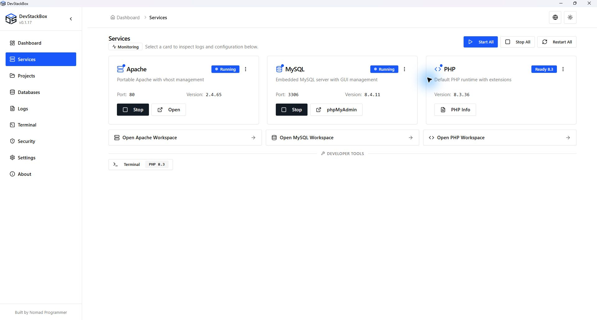

# DevStackBox

**Free XAMPP alternative for Windows** - Apache, MySQL 8.4 LTS, phpMyAdmin, and PHP 8.3 in one MIT-licensed desktop app.

Project details from an earlier development build. See [CHANGELOG.md](CHANGELOG.md) for the latest release notes.

## Stack

| In the installer   | In the app (download)                        |
| ------------------ | -------------------------------------------- |
| PHP **8.3.36**     | PHP **8.2.35, 8.4.27, 8.5.12** or newer patches |
| Apache **2.4**     | -                                            |
| MySQL **8.4 LTS**  | -                                            |
| phpMyAdmin **5.2** | -                                            |

XAMPP for Windows ships PHP 8.2. DevStackBox gives you 8.3 immediately and 8.5 when you need it.

## Download

[devstackbox.com/download](https://www.devstackbox.com/download) · [GitHub Releases](https://github.com/DevStackBox/DevStackBox/releases/latest)

1. Run the installer (administrator).
2. Start Apache and MySQL from the app.
3. Open `http://localhost/` and `http://localhost/phpmyadmin/`.

## Features

- One desktop UI for services, configs, SSL, backups, and projects
- Import from XAMPP (`Settings → Import from XAMPP`)
- No telemetry · offline-friendly after install

## Docs

[devstackbox.com/docs](https://www.devstackbox.com/docs)

Using an AI coding tool? Give it [DEVSTACKBOX.md](DEVSTACKBOX.md) for runtime discovery, project setup and database guidance.

## Project workspaces

Connect existing folders, manage `.test` hosts and trusted HTTPS, and select an installed PHP version per website. Download extra runtimes in PHP Versions first. The terminal currently uses global PHP.

See the [project guide](docs/getting-started/projects.mdx), [project roadmap](PROJECT-ROADMAP.md), and [release validation](docs/RELEASE-VALIDATION.md). Framework installers, database linking and Git/SSH are future work. Frameworks will download on demand; AI integration is deferred.

## v0.1.17

Released on 23 October 2026, v0.1.17 fixes Apache ancestor `.htaccess` handling and adds configuration/log diagnostics. Published artifact verification and remaining installed-site checks are tracked in [release validation](docs/RELEASE-VALIDATION.md). See the [documentation and cleanup audit](docs/development/v0.1.17-docs-audit.md) for readiness gates and proposed cleanup; no development files were deleted.

## Releasing

Maintainers: follow [Release process](docs/development/release-process.mdx) and the [Release runbook](docs/development/release-runbook.mdx) for signed builds, `finalize-release`, and GitHub publication. Download links for users always resolve to the [latest published GitHub release](https://github.com/DevStackBox/DevStackBox/releases/latest).

## Diagnostics and configuration safety

Read Apache and the selected PHP runtime error log from project details. Site changes preserve recovery copies and stop before overwriting unrelated hosts missing from saved records. See [release notes](CHANGELOG.md) for scope and limitations.

## Contributing

See [CONTRIBUTING.md](CONTRIBUTING.md).

## Links

- Website: [devstackbox.com](https://www.devstackbox.com)
- Issues: [GitHub Issues](https://github.com/DevStackBox/DevStackBox/issues)
- Security: [SECURITY.md](SECURITY.md) · Privacy: [PRIVACY.md](PRIVACY.md)
