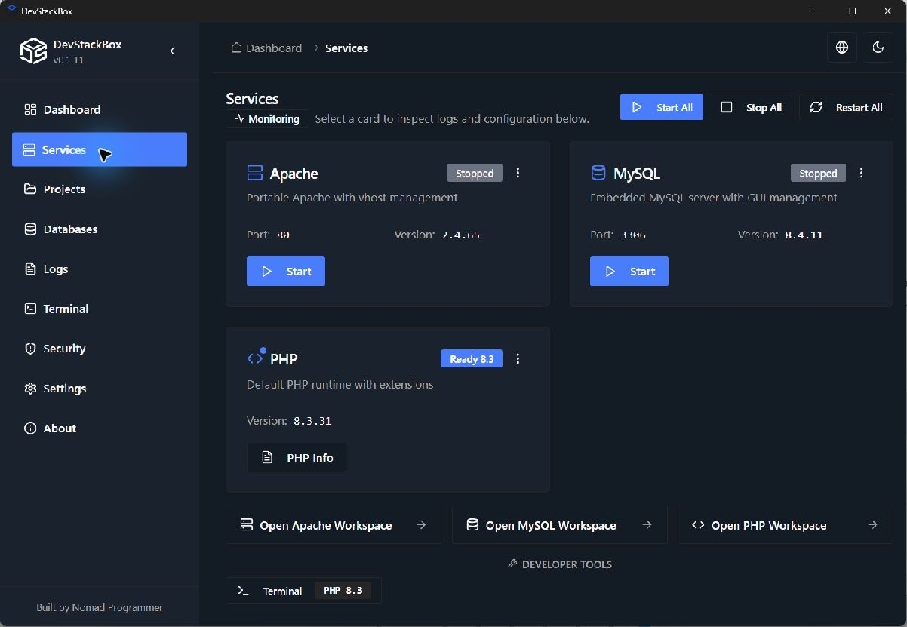

# DevStackBox

**Free XAMPP alternative for Windows** - Apache, MySQL 8.4 LTS, phpMyAdmin, and PHP 8.3 in one MIT-licensed desktop app.

## Stack

| In the installer   | In the app (download)                        |
| ------------------ | -------------------------------------------- |
| PHP **8.3**        | PHP **8.1, 8.2, 8.4, 8.5** (latest: **8.5**) |
| Apache **2.4**     | -                                            |
| MySQL **8.4 LTS**  | -                                            |
| phpMyAdmin **5.2** | -                                            |

XAMPP for Windows ships PHP 8.2. DevStackBox gives you 8.3 immediately and 8.5 when you need it.

## Download

[devstackbox.com/download](https://www.devstackbox.com/download) · [GitHub Releases](https://github.com/DevStackBox/DevStackBox/releases/latest)

1. Run the installer (administrator).
2. Start Apache and MySQL from the app.
3. Open `http://localhost/` and `http://localhost/phpmyadmin/`.

## Features

- One desktop UI for services, configs, SSL, backups, and projects
- Import from XAMPP (`Settings → Import from XAMPP`)
- No telemetry · offline-friendly after install

## Docs

[devstackbox.com/docs](https://www.devstackbox.com/docs)

## Project workspace roadmap

See the [full project roadmap](PROJECT-ROADMAP.md) for project details,
per-project PHP, matching terminals/tools, database connections and Git/SSH.
Implementation has started; these capabilities are not all shipped.
AI/MCP integration is deferred and excluded from current work.

- Keep PHP downloads and extension management in the existing PHP options.
  Projects will select an installed version or inherit the default; pinned
  projects will use that PHP for their website, terminal and managed tasks.
- WordPress and Laravel will download from upstream on demand when requested.
  Their applications and dependencies will not be bundled in the installer.
- Start with saved-site/configuration consistency and health checks, then prove
  independent PHP versions for two projects before building the full details UI.

Current HTTPS behavior and test limits are documented in
[Local HTTPS](docs/LOCAL-HTTPS.md) and the
[0.1.12 validation report](HTTPS-RELEASE-VALIDATION.md).

## Contributing

See [CONTRIBUTING.md](CONTRIBUTING.md).

## Links

- Website: [devstackbox.com](https://www.devstackbox.com)
- Issues: [GitHub Issues](https://github.com/DevStackBox/DevStackBox/issues)
- Security: [SECURITY.md](SECURITY.md) · Privacy: [PRIVACY.md](PRIVACY.md)
