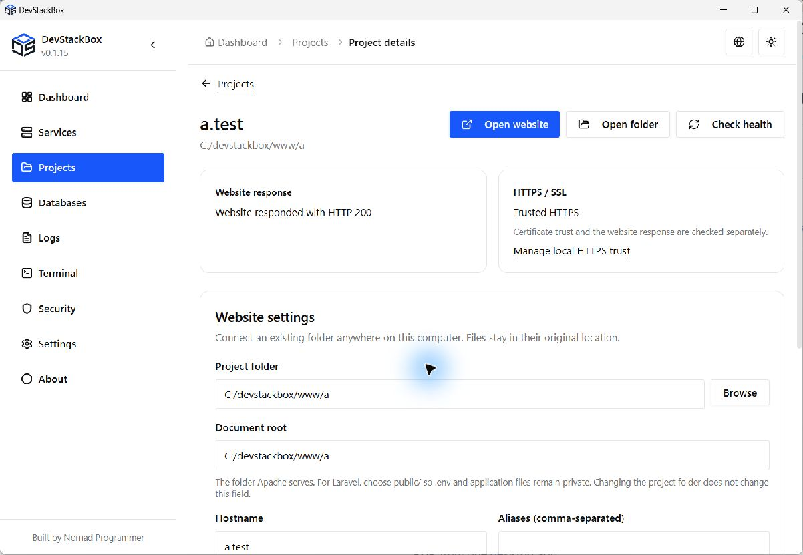

# DevStackBox

**Free XAMPP alternative for Windows** - Apache, MySQL 8.4 LTS, phpMyAdmin, and PHP 8.3 in one MIT-licensed desktop app.

Project details from an earlier development build. See the changelog for v0.1.14 changes.

## Stack

| In the installer   | In the app (download)                        |
| ------------------ | -------------------------------------------- |
| PHP **8.3.36**     | PHP **8.2.35, 8.4.27, 8.5.12** or newer patches |
| Apache **2.4**     | -                                            |
| MySQL **8.4 LTS**  | -                                            |
| phpMyAdmin **5.2** | -                                            |

XAMPP for Windows ships PHP 8.2. DevStackBox gives you 8.3 immediately and 8.5 when you need it.

## Download

[devstackbox.com/download](https://www.devstackbox.com/download) · [GitHub Releases](https://github.com/DevStackBox/DevStackBox/releases/latest)

1. Run the installer (administrator).
2. Start Apache and MySQL from the app.
3. Open `http://localhost/` and `http://localhost/phpmyadmin/`.

## Features

- One desktop UI for services, configs, SSL, backups, and projects
- Import from XAMPP (`Settings → Import from XAMPP`)
- No telemetry · offline-friendly after install

## Docs

[devstackbox.com/docs](https://www.devstackbox.com/docs)

## Project workspaces

Connect existing folders, manage `.test` hosts and trusted HTTPS, and select an installed PHP version per website. Download extra runtimes in PHP Versions first. The terminal currently uses global PHP.

See the [project guide](docs/getting-started/projects.mdx), [project roadmap](PROJECT-ROADMAP.md), and [release validation](docs/RELEASE-VALIDATION.md). Framework installers, database linking and Git/SSH are future work. Frameworks will download on demand; AI integration is deferred.

## v0.1.14 PHP security update

Bundles PHP 8.3.36 for CVE-2026-109618 and CVE-2026-109619. PHP Version Manager shows both branch and full patch versions and updates existing branches with verified downloads. PHP 8.1 has been removed from supported choices. Stop Apache and PHP terminals before updating each installed branch, including those pinned to projects. Apache startup rejects outdated web runtimes until they are updated.

Version 0.1.14 is prepared in this source tree; download links resolve to the latest published GitHub release. Generate the final installer and updater metadata using the release runbook before publication.

## Diagnostics and configuration safety

Read Apache and the selected PHP runtime error log from project details. Site changes preserve recovery copies and stop before overwriting unrelated hosts missing from saved records. See [release notes](CHANGELOG.md) for scope and limitations.

## Contributing

See [CONTRIBUTING.md](CONTRIBUTING.md).

## Links

- Website: [devstackbox.com](https://www.devstackbox.com)
- Issues: [GitHub Issues](https://github.com/DevStackBox/DevStackBox/issues)
- Security: [SECURITY.md](SECURITY.md) · Privacy: [PRIVACY.md](PRIVACY.md)
