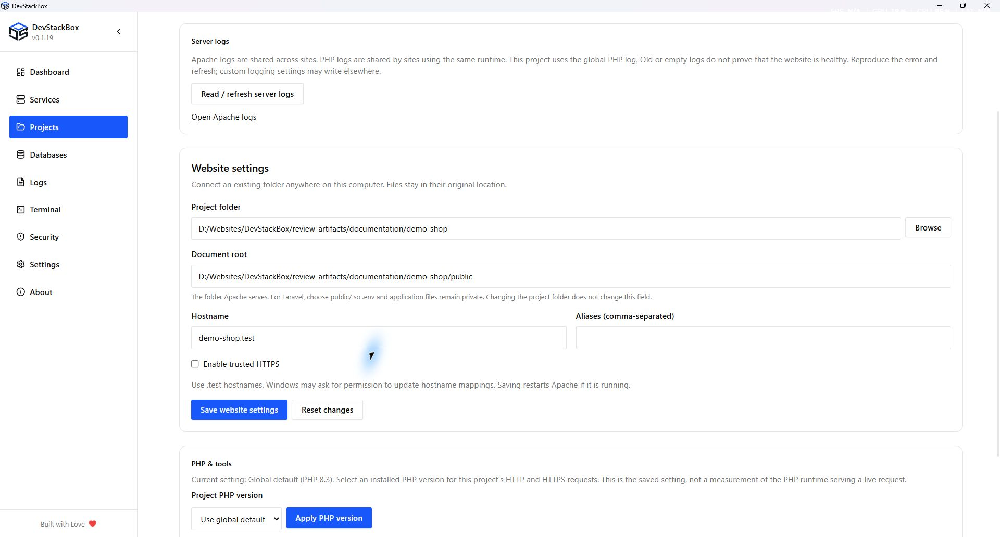

Pin an installed PHP branch to each project in **Projects → Manage project → PHP & tools**. Apache can then serve both sites at the same time. The Windows PHP command follows the global default.

[Watch the captioned demo](/community#two-php-versions) or [download DevStackBox for Windows](/download).

## Set up two local sites

1. [Install DevStackBox for Windows](installation). Open **Services → PHP → Versions**. This example uses the bundled 8.3 branch and an installed 8.5 branch. Choose **Download** beside 8.5 if needed. Leave your usual global default selected.
2. Create two empty folders named `catalog` and `studio` somewhere you can write. In **each** folder save the following as `version.php`. The page only prints the runtime version.

```php
<?php
header('Content-Type: text/plain');
echo PHP_VERSION;
```

3. In **Projects → Add project / site**, connect the catalog folder using `catalog.test`. Use the folder itself as the document root. Repeat for the studio folder using `studio.test`. Both names must be unused. Allow the Windows hosts update if prompted.
4. Open **Manage project → PHP & tools** for catalog, choose **8.3**, and apply. Choose **8.5** for studio and apply. Start Apache and follow any restart prompt after saving.



## Check the runtime serving each request

Open `http://catalog.test/version.php` and `http://studio.test/version.php` in separate tabs. Use your configured port if Apache listens on a port other than 80. In a fresh Windows terminal run:

```powershell
where.exe php
php -v
```

| Request | Result from the example |
| --- | --- |
| catalog.test/version.php | 8.3.36 |
| studio.test/version.php | 8.5.12 |
| php -v | 8.4.27 (cli) |

These results were measured on 19 November 2026 using the installed v0.1.22 Apache and PHP binaries in an isolated local host configuration. Your patch numbers and CLI default may differ.

If both sites show the same version, check the hostname, each site's saved selection, and whether Apache loaded the change. For an unexpected CLI version, the first result from `where.exe php` shows which launcher Windows found. See [PHP runtimes and extensions](../user-guide/php).

## Return a site to the default

Choose **Use global default** for that project, apply it, then reload both URLs. The other site should still use its pinned branch. Remove the demonstration files when finished. [Release v0.1.22](https://github.com/DevStackBox/DevStackBox/releases/tag/v0.1.22)
