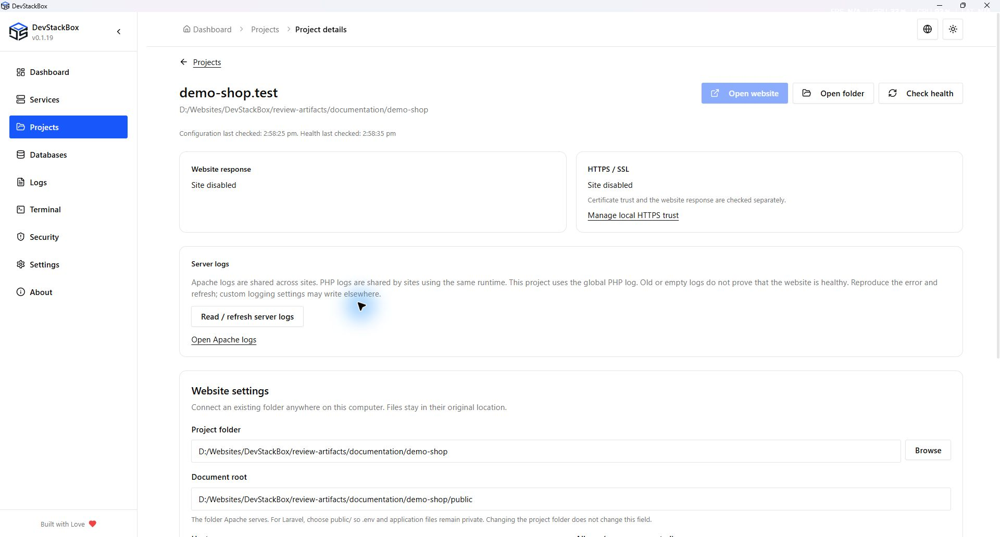
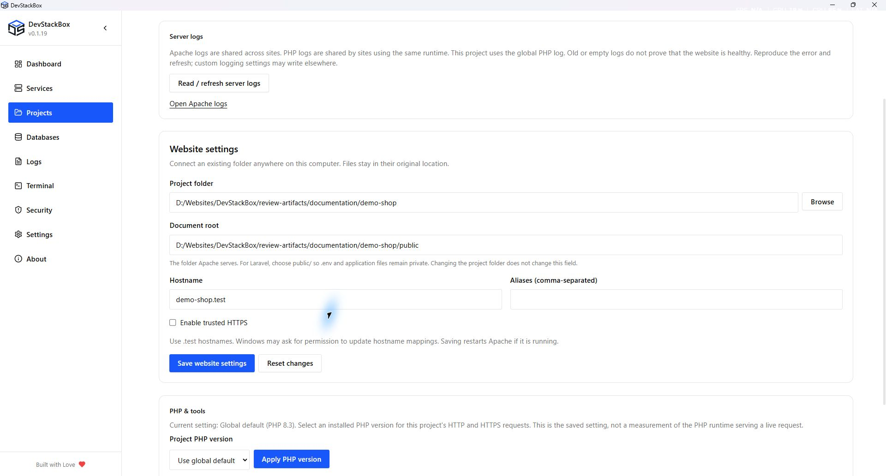
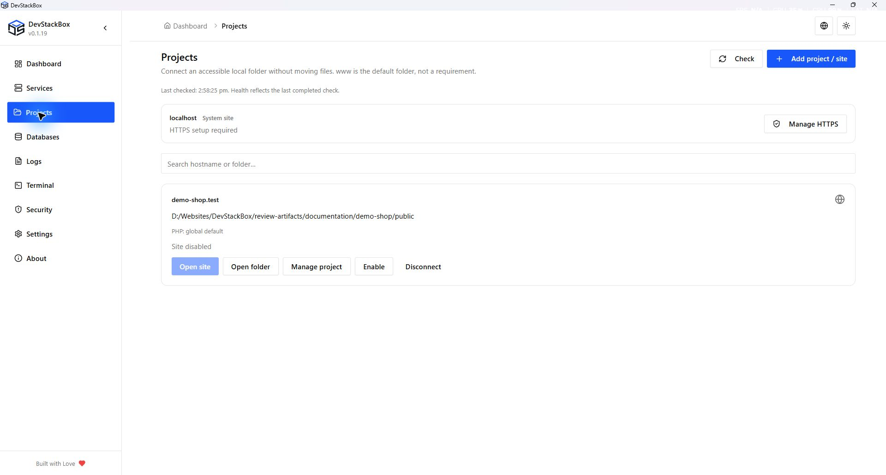

# One place for each project

Available since **v0.1.12**: connect existing folders, select PHP per website, and manage trusted local HTTPS from project details.

Since v0.1.19, project metadata and previous health results stay in memory when navigating between screens. Stale metadata refreshes in the background; health shows when it was last checked and can be rechecked explicitly. A previous successful check is not a guarantee that the website is reachable now. Background refresh preserves unsaved fields, and saving checks for configuration changes made since editing began. The details screen uses the available workspace width.

## Project folders and the default www directory

Projects can stay in any accessible local directory, including another drive. Connecting a folder creates a site configuration without copying or moving its files. The www directory under the installation is the default for newly created folders and localhost; it is not a requirement for connected projects. Apache must be able to read the selected directory.

The project folder contains the application; the document root is the folder served to visitors. For Laravel, choose public/ as the document root. Open connected projects using their .test hostnames; Open localhost opens only the default site.

Full backups include configuration, files under www and a MySQL dump when available. External project file contents are not included, even though their site configuration may be saved. Back up those folders separately before upgrades or restoration.

## Connect an existing website

1. Open **Projects → Add project / site** and select a local folder, including folders outside `www`.
2. Choose a unique `.test` hostname and optional aliases.
3. Review the document root. Laravel applications should serve `public/`, not the repository root.
4. Enable HTTPS if wanted, save, and start Apache. Windows may request permission to update its hosts file.
5. Open **Manage project** to edit settings, check the site response, or open its folder.

Connecting does not copy files or install dependencies. Disconnecting keeps your files. Projects and Virtual Hosts share the same saved site records.

## Select PHP for a project

## Edit, disable or disconnect

Manage project shows the saved folder, document root, hostname, aliases and HTTPS choice. Save changes and read the result; a failed validation or hosts-file operation can prevent the new configuration from taking effect. Use the returned error and retained configuration copies before retrying.

Choose a unique `.test` hostname without a URL scheme, port or path. Aliases must not collide with another saved site. The folder picker selects an existing directory; connecting does not install frameworks or dependencies. A create-folder option creates files under the default www location, while connecting an existing folder leaves it in place.

Disabling a site stops it being served through its generated configuration while retaining its record. Disconnecting removes the site configuration rather than deleting project files or databases. Read the confirmation and open the intended hostname afterward to verify changes. Projects and Apache Virtual Hosts edit the same records; do not maintain separate duplicate entries.

The response check measures an HTTP result; HTTPS trust and the saved PHP selection are separate. The open-folder action opens the saved location. A missing folder must be restored or reconnected before the site can work. A configuration-review warning means existing generated configuration needs attention; do not delete unrelated records to dismiss it.

## Select the website PHP runtime

Download PHP in **Services → PHP → Versions** first. In **Projects → Manage project → PHP & tools**, choose an installed runtime and apply. Select **Use global default** to follow the stack default again.

A pinned runtime handles that site's HTTP and HTTPS independently of other projects. Missing or invalid runtimes cannot be selected. The terminal still uses global PHP; project-aware terminal sessions are future work.

Pinned runtimes use a separate generated php.ini per version. Custom global php.ini settings are not copied automatically. Per-version extension editing is not yet available in the UI.

## Trusted local HTTPS

Open **Services → Apache → HTTPS / SSL** to set up or repair localhost HTTPS. Review and approve the Windows trust prompt yourself to trust the local certificate authority. HTTPS can also be managed from project details.

DevStackBox bundles mkcert and issues certificates locally. Private CA keys are not distributed. Localhost covers `localhost`, `127.0.0.1`, and `::1`; each project certificate covers its hostname and aliases. `.test` is the app's naming policy, not a mkcert limitation.

A trusted result requires a live check. Browser policies can differ; a green browser icon is not guaranteed. Do not bypass certificate warnings: check hostname, trust status, and Apache configuration.

## Trusted HTTPS but a 404 page?

TLS trust and website health are separate. Check the document root, index.php/index.html, framework dependencies, rewrite rules, and application routes. An empty folder is not a working website. Use the project health check to distinguish routing problems from certificate problems.

## Diagnose website errors (v0.1.13)

### Parent .htaccess errors (v0.1.17)

DevStackBox explicitly ignores `.htaccess` above a site's document root. The document root and its children still allow `.htaccess`, including Laravel's `public/.htaccess`. HTTP and HTTPS use the same policy; project files are not modified.

Select the Laravel application's `public` directory. Explicit custom Apache directory policies remain in effect; projects intentionally using parent rules can keep a narrowly scoped `<Directory>` policy in their user Apache configuration.

After upgrading, configuration preparation syntax-checks the additive migration and retains a timestamped `httpd.*.pre-overrides.conf` backup beside `httpd.conf`. Saved sites are not regenerated or deleted. Restart Apache to load the policy. Failed validation retains the original configuration and reports the error.

An error naming the parent `.htaccess` with `<IfModule not allowed here` occurs before Laravel executes. A working HTTPS health endpoint alone does not test application rewrite rules. The log viewer includes its file path for comparison with Apache's `ErrorLog` setting; custom log destinations must still be opened separately.

Open **Manage project → Server logs** to read Apache errors and the PHP error log for the saved runtime selection. Each log reports read failures independently. Logs are shared across projects using the same service or PHP runtime; check timestamps and paths before attributing an entry to this site. Empty or old logs do not prove that the website is healthy, and custom log destinations may differ.

The PHP selector shows the saved configuration, not a live measurement of website PHP. A trusted HTTPS connection can still return HTTP 404 or 500.

If a site change reports generated hosts missing from saved records, inspect the existing configuration before proceeding. Reconnect the intended site rather than deleting unrelated hosts. Pre-change site configuration copies are retained under the user configuration backups directory for manual recovery; they are not a complete project/database backup.

## Planned, not bundled

Project database linking, project-aware terminals, Git/SSH, and Laravel/WordPress installation are future work. Frameworks will download from upstream on demand, not ship in the installer. AI integration is deferred.

*Native 1920 × 1032 capture of the v0.1.19 production build, 26 October 2026, using an isolated demonstration profile. Screenshots document the interface; download availability is shown separately on the website.*

*Native 1920 × 1032 capture of the v0.1.19 production build, 26 October 2026, using an isolated demonstration profile. Screenshots document the interface; download availability is shown separately on the website.*

*Native 1920 × 1032 capture of the v0.1.19 production build, 26 October 2026. Isolated demonstration profile; release availability is shown separately.*
