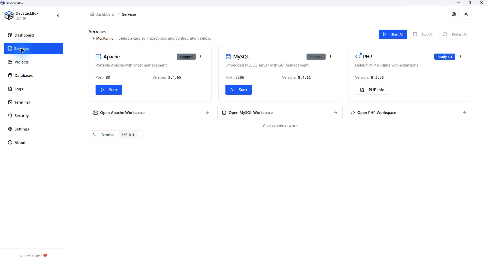

# DevStackBox documentation

Start here for installation, configuration, troubleshooting, and contributor guides.

Using an AI coding tool? Give it the [DevStackBox environment guide](https://www.devstackbox.com/DEVSTACKBOX.md) before working on your application.

v0.1.19 production build, captured at native 1920 × 1032 with isolated demonstration data. [Open the original screenshot](images/v0.1.19/services.jpg) to inspect the interface at full size.

Find every screen and workflow in the [application guide map](user-guide/application-map).

## Getting started

| Guide                                        | Description                          |
| -------------------------------------------- | ------------------------------------ |
| [Installation](getting-started/installation) | Install DevStackBox on Windows 10/11 |
| [Upgrading](getting-started/upgrading)       | Upgrade in place without losing data |
| [Projects, PHP & HTTPS](getting-started/projects) | Connect local folders and configure each website |

Download the latest installer from [devstackbox.com/download](https://www.devstackbox.com/download).

## Project status

For everyday tasks, start with [Dashboard](user-guide/dashboard), [Services](user-guide/services), [PHP](user-guide/php), [Databases and users](user-guide/databases) or [Terminal](user-guide/terminal).

Before changing files or data, read [Configuration editing](user-guide/configuration-editor), [SQL restoration](user-guide/database-backups) and [Full backup](user-guide/full-backup). [Logs](user-guide/logs), [Security checks](user-guide/security) and [Local HTTPS](user-guide/local-https) explain diagnosis. [Settings](user-guide/settings) covers startup, tray, updates and About; [XAMPP migration](user-guide/xampp-migration) covers connecting or copying existing projects.

| Guide                            | Description                            |
| -------------------------------- | -------------------------------------- |
| [Roadmap](roadmap)               | What we are building and in what order |
| [Feature status](feature-status) | Shipped, partial, and planned features |
| [FAQ](faq)                       | Common questions                       |

## Reference

| Guide                                      | Description                                 |
| ------------------------------------------ | ------------------------------------------- |
| [Configuration](reference/configuration)   | Ports, config files, defaults               |
| [Commands](reference/commands)             | Tauri backend command reference             |
| [Installer & updates](reference/installer) | NSIS installer and auto-update architecture |

## Advanced

| Guide                                            | Description                             |
| ------------------------------------------------ | --------------------------------------- |
| [Environment & networking](advanced/environment) | Ports, localhost binding, virtual hosts |
| [Troubleshooting](advanced/troubleshooting)      | Errors, known issues, fixes             |

## Development

| Guide                                            | Description               |
| ------------------------------------------------ | ------------------------- |
| [Building from source](development/building)     | Local dev setup           |
| [Architecture](development/architecture)         | How components connect    |
| [Components](development/components)             | React component inventory |
| [Coding standards](development/coding-standards) | Writing, UI, terminology  |
| [Release process](development/release-process)   | Shipping a release        |
| [Testing](development/testing)                   | Test strategy             |
| [Architecture decisions](development/adr)  | ADR index                 |

## Before you start a task

1. What to build next? → [Roadmap](roadmap)
2. Does the feature exist? → [Feature status](feature-status)
3. Does the component exist? → [Components](development/components)
4. Does the Tauri command exist? → [Commands](reference/commands)
5. Known bugs or debt? → [Troubleshooting](advanced/troubleshooting)
6. Where does code go? → [Architecture](development/architecture)

When adding or renaming a doc page, update [`navigation.ts`](https://github.com/DevStackBox/DevStackBox/blob/main/docs/navigation.ts) in the same pull request.

## Policy

- [Security policy](https://www.devstackbox.com/security)
- [Privacy policy](https://www.devstackbox.com/privacy)
- [Contributing](https://github.com/DevStackBox/DevStackBox/blob/main/CONTRIBUTING.md)
