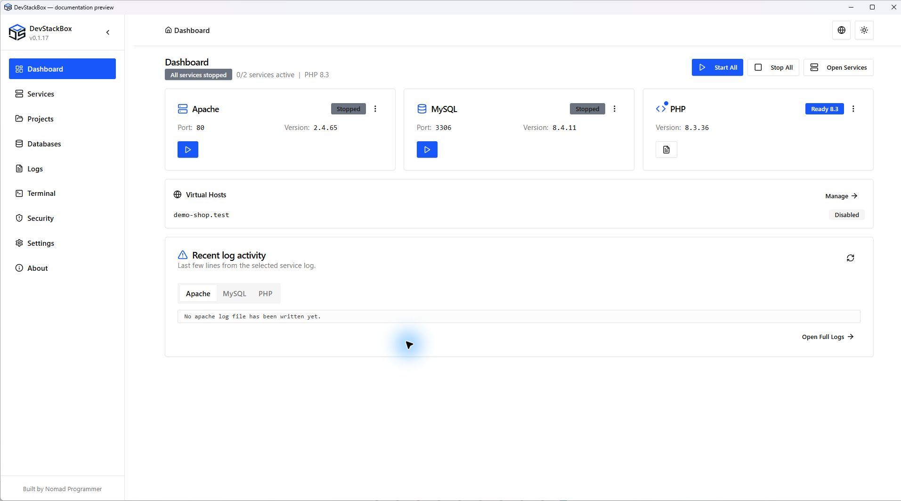

# Dashboard and navigation

The **Dashboard** summarizes Apache and MySQL, the global PHP runtime, connected virtual hosts and recent service logs.

## First launch

The welcome dialog offers **Start all services** or **Explore first**. Choose Explore first to inspect configuration before starting services. Closing the dialog completes onboarding; it does not install project dependencies. A separate root-password prompt may direct you to database users. Dismissing that prompt is not the same as securing the account; see [Databases and users](databases).

## Read status and open a project

1. Check each service card. Running means the managed server process is running; it does not prove that every website or database request succeeds.
2. PHP is a runtime used by Apache and terminals, so its Ready badge is different from a server's Running badge. The short branch and full patch number identify different levels of the same version.
3. Use a connected project's hostname to open that website. The Apache open action opens the default localhost site.
4. For project response, HTTPS or PHP checks, open **Projects → Manage project**. Recent logs can contain activity from more than one site.

**Start All** and **Stop All** act on the managed server services. Use [Services](services) for individual controls and startup failures.

## Navigation and commands

The sidebar opens Services, Projects, Databases, Logs, Terminal, Security, Settings and About. Service cards have overflow menus and context menus for related configuration and logs. A collapsed sidebar can be expanded again.

Press **Ctrl+P** to open the command palette. Search for a destination or action, select it and press Enter; Escape closes the palette. Navigation entries open a screen, while service actions change running state. Prefer the Services screen when you need to inspect the result of an action.

Theme and language controls are available in the header and [Settings](settings). Closing the app window may hide it in the tray; see the close/quit distinction in that guide.

## When a status looks wrong

Refresh in Services and compare the relevant [log](logs), process state and actual project response. A blank or old log is not evidence of success. Report the app version from About, the failing action, timestamp and relevant error text; remove credentials and personal paths first.

*Source preview captured 23 October 2026; includes unreleased wording changes. Demo state, not recommended settings.*
