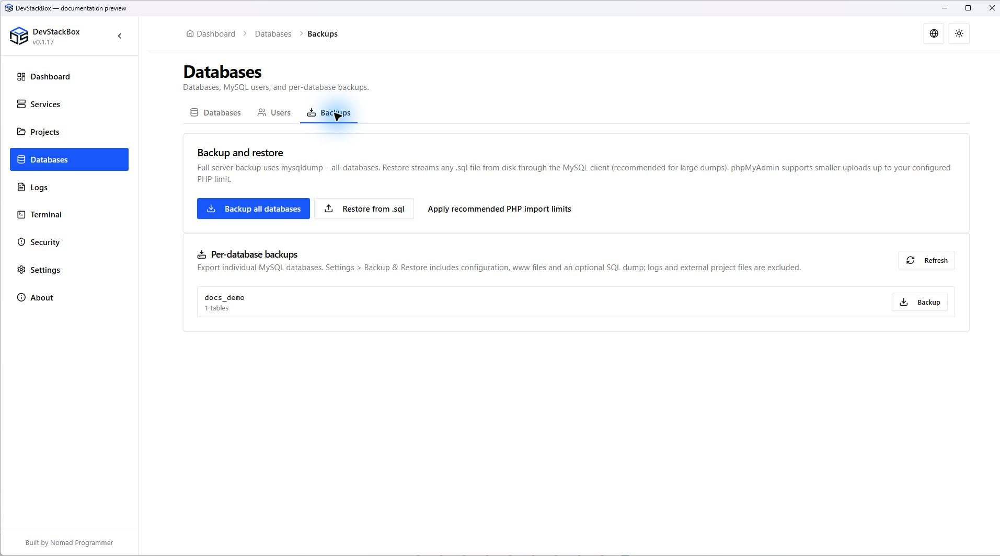
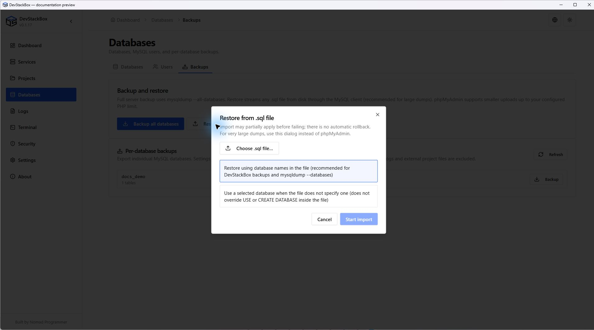
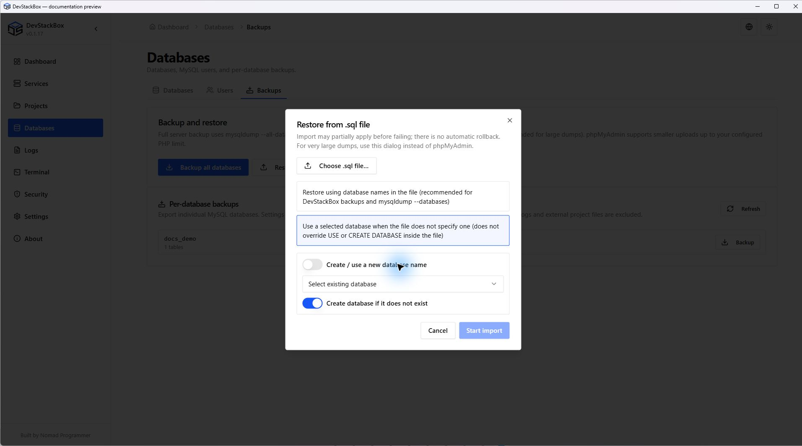

# SQL backups and restoration

Open **Databases → Backups** with MySQL running and working local credentials. These actions create SQL exports; they are different from the ZIP archives in **Settings → Backup & Restore**.

## Export SQL

1. Choose **Backup all databases** for a server dump or the backup action beside one database.
2. Wait for completion and note the reported file destination.
3. Keep the SQL file outside the data you plan to replace. Verify a restoration using disposable data before relying on an important backup.

A server dump can contain users, system databases and statements affecting more than one application. It is not interchangeable with a single-database export.

## Restore from .sql

1. Choose **Restore from .sql** and pick a local SQL file.
2. Review the filename, size and any detection hint. A hint is not a complete SQL safety analysis.
3. Choose the restore mode below and review the impact warning.
4. Start the import, keep the app open and wait for its result.
5. Refresh the database list, inspect the imported objects and test the application.

| Mode | Meaning |
| --- | --- |
| Restore using database names in the file (follow dump) | SQL statements such as CREATE DATABASE and USE determine the target. Appropriate when the dump contains its own database selection. |
| Use a selected database when the file does not specify one (initial database) | Starts the client with the selected existing database, or the entered new name when creation is enabled. Later USE statements in the file can still select another database. |

Selecting an initial database is **not** a sandbox that confines every statement to it. Read and trust the dump before running it. SQL can change or delete existing objects. Imports are not globally transactional; an error may leave some statements applied. Back up the affected databases first and use a disposable database for test restores.

## Large imports and phpMyAdmin

Native restoration streams the file through the MySQL client and avoids browser upload limits. phpMyAdmin uploads are governed by the global PHP configuration and can fail before SQL execution.

**Apply recommended PHP import limits** explicitly sets upload size to 512M, POST size to 544M and execution time to 600 seconds in global php.ini. It can replace custom values for those settings. Restart Apache afterward. This does not remove MySQL packet, SQL compatibility or server resource limits.

## A backup or restore failed

Keep the error and the source file. Check MySQL availability, credentials, destination permissions and disk space. If the dump contains unsupported syntax or references unavailable databases, fix a copy or obtain a compatible export. Retrying an import blindly may duplicate data or repeat partial changes.

Full-stack archives, external-folder exclusions and restoration of configuration are covered in [Full backup and restore](full-backup).

*Source preview, 23 October 2026. Isolated demonstration data; includes unreleased wording changes.*

*Source preview, 23 October 2026. Isolated demonstration data; includes unreleased wording changes.*

*Source preview, 23 October 2026. Isolated demonstration data; includes unreleased wording changes.*
