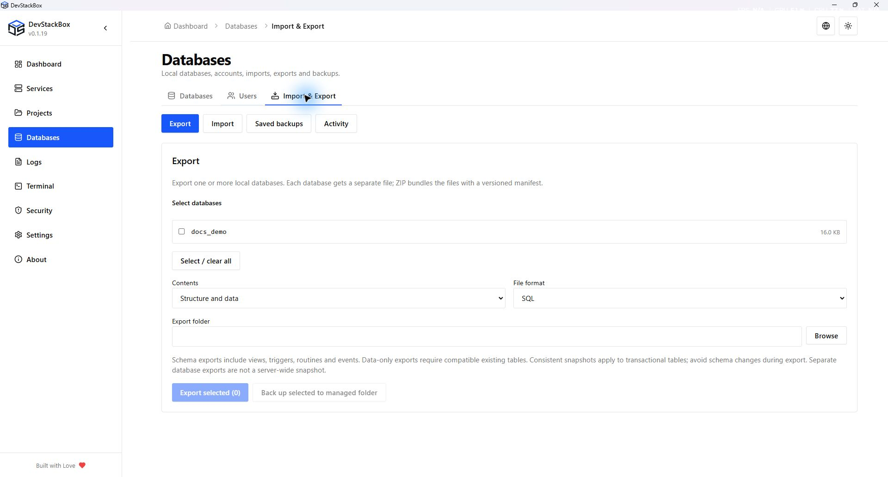
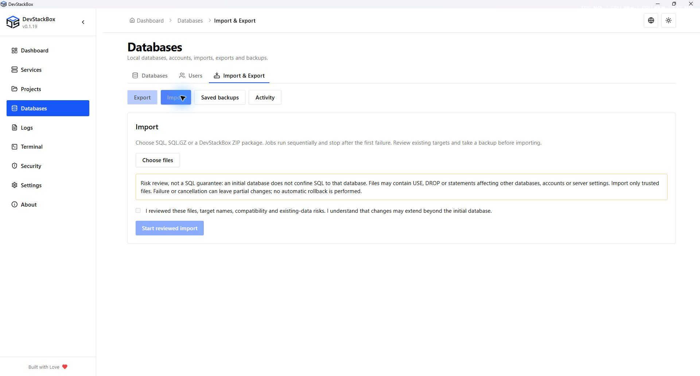
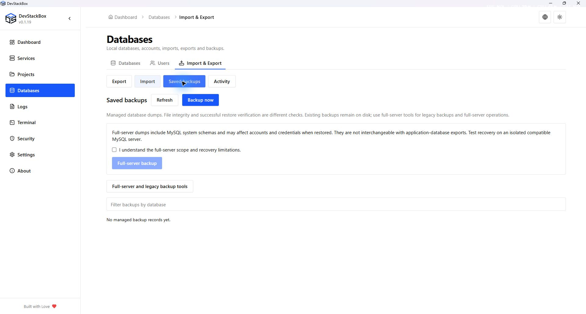
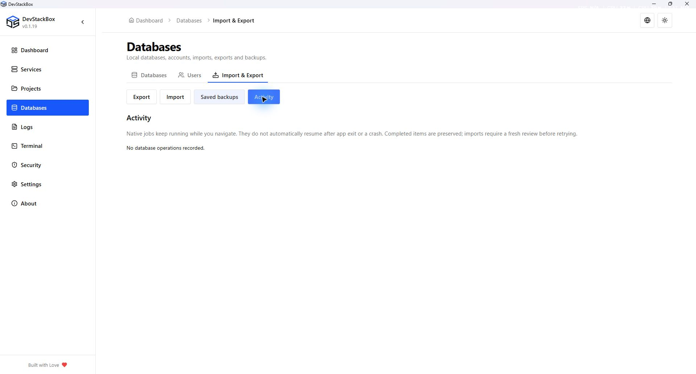

# SQL import, export and backups

Open **Databases → Import & Export** with MySQL running and working local credentials. These actions create SQL exports; they are different from the ZIP archives in **Settings → Backup & Restore**.

## Import & Export

Open **Databases → Import & Export**. The workspace opens on Export with sections for Export, Import, Saved backups, and Activity. Older Backups links redirect here.

### Export and backup

Select one or several databases, choose structure and data, structure only or data only, then SQL, SQL.GZ or a DevStackBox ZIP package and an output folder. Each database is exported separately. ZIP includes a versioned manifest with source version, character set/collation, included objects, sizes and checksums. Backup selected uses recovery-oriented SQL defaults and records files in the managed backup folder.

Schema exports include views, triggers, routines and events. Data-only exports need compatible pre-existing tables. Transactional tables use a consistent-snapshot option; nontransactional tables and concurrent schema changes require care. Separate exports are not one server-wide snapshot.

### Import risk review

Choose SQL, SQL.GZ, a ZIP containing exactly one SQL file at its root, or a supported DevStackBox ZIP package, then review files and initial targets. Ordinary SQL ZIPs allow an initial database just like uncompressed SQL; their filenames do not determine a database name. ZIPs containing folders, multiple SQL files or unrelated files are rejected; extract and review those SQL files separately. An existing initial target may be changed; a missing one is created. A blank target follows names in the SQL. Packages use their recorded database names and are imported individually. Original-name arbitrary SQL files are also imported individually because their targets may overlap. Multiple explicitly selected initial databases must be distinct.

An initial target is **not a confinement boundary**. SQL can contain USE, schema-qualified statements, destructive SQL or account changes. A preview cannot prove the full effects of arbitrary SQL. Only import trusted files; check engine/version, character set and collation compatibility and back up affected data first. No database-name search-and-replace is performed.

ZIP manifests and paths are validated, including duplicate names, unsupported entries, links, path traversal, expansion limits and file checksums. SQL files are still executable input after integrity verification. Current input/expanded package limits are 32 GiB and 100 selected items, with an archive expansion-ratio limit of 1000.

### Activity, cancellation and partial results

Native jobs continue when navigating between screens. Jobs run sequentially and stop after the first failure. Activity records completed, failed, cancelled and unstarted items separately. **Review unfinished imports** prepares a new review; it does not replay SQL automatically. The user must review the files and acknowledge the risk again.

Exports report bytes written without inventing a completion percentage. Import progress shows operation state rather than claiming bytes read equal committed SQL. Cancellation terminates the active client and prevents pending work; earlier SQL may already be applied. There is no automatic rollback. App close/quit is blocked while an operation is active; an external crash can still interrupt it, and unfinished history is marked interrupted on restart.

### Saved backups

Filter by database; review source metadata, open the file's folder, check integrity, restore through the import review, or delete the backup file by typing its database name. Deleting a backup never deletes the database. Missing files and checksum mismatches are distinct states. A matching checksum does **not** establish that restoration was tested: the UI labels restore verification separately.

Saved backups also offers **Full-server backup** with an explicit scope acknowledgement and the same Activity records. Restoring these files can affect system schemas, accounts and credentials; test recovery separately before relying on them. Older backup files are retained on disk. **Full-server and legacy backup tools** opens the original SQL controls for compatibility; those older controls do not create new per-item Activity records. Settings archives remain a separate application/configuration workflow.

### Workspace screenshots

Native 1920 × 1032 capture of the v0.1.19 production build, 26 October 2026, using an isolated demonstration profile. Screenshots document the interface; download availability is shown separately on the website.

*Export format and backup controls.*

*Import file selection and risk acknowledgement before selecting a file.*

*Saved backups, including the empty state and full-server scope acknowledgement.*

*Activity before the first operation. Completed jobs appear here with item results.*

## Legacy SQL export (compatibility)

1. Open **Saved backups → Full-server and legacy backup tools**. Choose **Backup all databases** for a server dump or the backup action beside one database.
2. Wait for completion and note the reported file destination.
3. Keep the SQL file outside the data you plan to replace. Verify a restoration using disposable data before relying on an important backup.

A server dump can contain users, system databases and statements affecting more than one application. It is not interchangeable with a single-database export.

## Restore from .sql

1. Choose **Restore from .sql** and pick a local SQL file.
2. Review the filename, size and any detection hint. A hint is not a complete SQL safety analysis.
3. Choose the restore mode below and review the impact warning.
4. Start the import, keep the app open and wait for its result.
5. Refresh the database list, inspect the imported objects and test the application.

| Mode | Meaning |
| --- | --- |
| Restore using database names in the file (follow dump) | SQL statements such as CREATE DATABASE and USE determine the target. Appropriate when the dump contains its own database selection. |
| Use a selected database when the file does not specify one (initial database) | Starts the client with the selected existing database, or the entered new name when creation is enabled. Later USE statements in the file can still select another database. |

Selecting an initial database is **not** a sandbox that confines every statement to it. Read and trust the dump before running it. SQL can change or delete existing objects. Imports are not globally transactional; an error may leave some statements applied. Back up the affected databases first and use a disposable database for test restores.

## Large imports and phpMyAdmin

Native restoration streams the file through the MySQL client and avoids browser upload limits. phpMyAdmin uploads are governed by the global PHP configuration and can fail before SQL execution.

**Apply recommended PHP import limits** explicitly sets upload size to 512M, POST size to 544M and execution time to 600 seconds in global php.ini. It can replace custom values for those settings. Restart Apache afterward. This does not remove MySQL packet, SQL compatibility or server resource limits.

## A backup or restore failed

Keep the error and the source file. Check MySQL availability, credentials, destination permissions and disk space. If the dump contains unsupported syntax or references unavailable databases, fix a copy or obtain a compatible export. Retrying an import blindly may duplicate data or repeat partial changes.

Full-stack archives, external-folder exclusions and restoration of configuration are covered in [Full backup and restore](full-backup).
