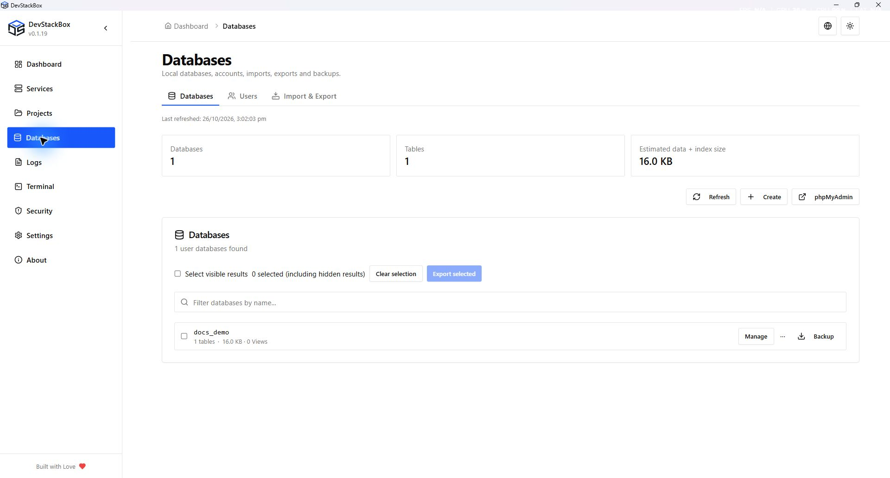
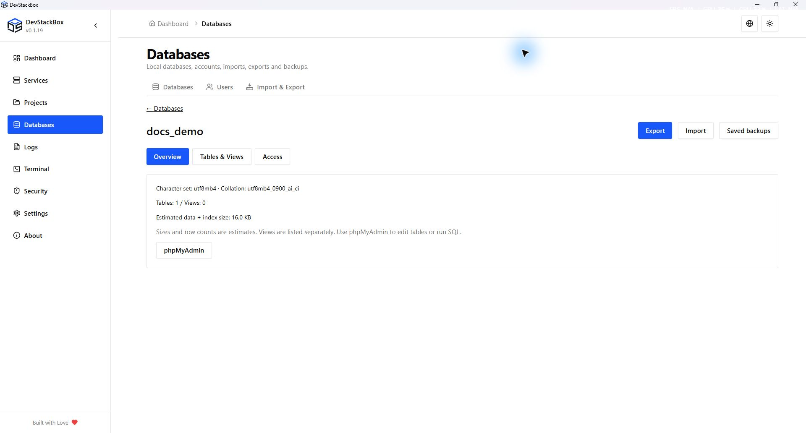
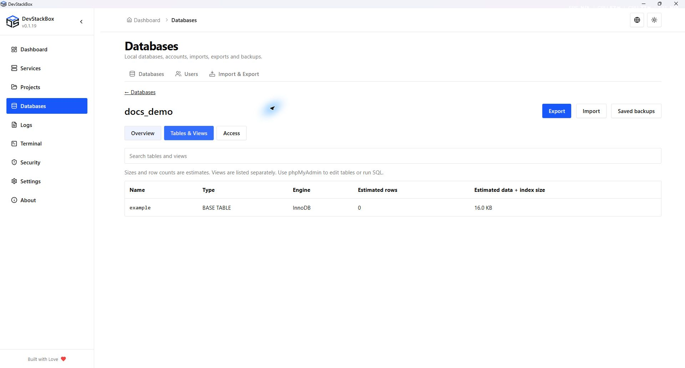
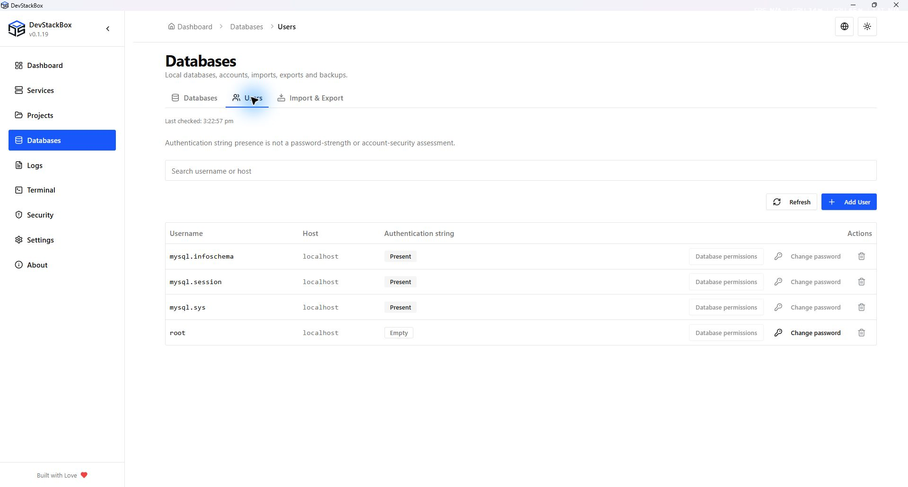

# Databases and MySQL users

Start MySQL before opening **Databases**. Open phpMyAdmin only when both Apache and MySQL are running. The app uses its configured local MySQL client credentials; an authentication error is different from an empty database list.

## Freshness and phpMyAdmin packaging

DevStackBox keeps database/user lists in memory between visits and refreshes them in the background while their screen is visible. Database names are checked about every 15 seconds; size estimates about every 60 seconds; users about every 30 seconds. Refresh remains available for an immediate check. Changes in phpMyAdmin can appear on the next scheduled check or when returning to the app. Errors do not mean the database list is empty; previous results can be marked outdated. Caches are not saved across app restarts.

New installer builds bundle the pmahomme phpMyAdmin theme only and hide the theme selector. Translations and offline help remain included. Older customized files can remain after an upgrade; cleanup does not remove unknown or edited files.

## Database workspace

**Databases | Users | Import & Export** replaces the older scattered database-only list for day-to-day management:

- Select databases in the list and choose **Export selected**, or use **Manage** for details. The visible action menu also provides import, backup, phpMyAdmin and deletion.
- Counts distinguish tables and views. Sizes and row counts are estimates, not an exact measurement of disk usage.
- The create dialog can use server defaults or a supported character set/collation. Database deletion requires the exact name; system schemas are protected by the native delete command.
- Details show metadata and a searchable table/view list. Access links to the shared account permission editor; saved backups open filtered to the database.
- The Users screen searches username and host and provides labeled password changes with confirmation. **Database permissions** edits direct database grants: Read only gives SELECT; Read/write adds INSERT, UPDATE and DELETE. Schema migrations need separately selected privileges. Review additions and removals before applying them.
- Unsupported global, role, table and routine grants are preserved. Direct grants are not a complete effective-access report. The editor refuses servers using partial revokes; use phpMyAdmin for that advanced policy. Administrative and system identities are protected from ordinary deletion and permission editing.
- When MySQL stops, cached names remain labeled stale. No live database query is required to display that state. New metadata is fetched after MySQL returns.

Creating an account and editing its grants remain separate explicit actions. Copy/migration, account renaming and remote transfer are not implemented in this workspace.

### Workspace screenshots

Native 1920 × 1032 capture of the v0.1.19 production build, 26 October 2026, using an isolated demonstration profile. Screenshots document the interface; download availability is shown separately on the website.

*Database list and visible actions.*

*Database overview and metadata.*

*Separate table and view listings.*

*Local MySQL accounts and protected system actions.*

## Create and inspect

1. Open **Databases** and refresh the list.
2. Choose the create action, enter the database name and submit.
3. Confirm the new name appears. Update your application's database connection settings separately; creating a database does not connect a project automatically.
4. Use the per-database backup action before risky changes. Use phpMyAdmin for tables, SQL queries and privileges not exposed by the desktop UI.

Search/filter controls affect the displayed list. Use the database action menu to find **Delete**. Deleting a database requires confirmation and removes its data; a successful deletion is not reversible without a suitable backup.

## Users and account hosts

Open **Databases → Users**. A MySQL account is a username plus a host, so `example@localhost` and the same name at another host are distinct accounts.

1. Choose the create-user action and enter username, host and password.
2. Review the account scope and create it.
3. Refresh the list to confirm the account.
4. Open **Database permissions**, select the database and required privileges, and review additions/removals before saving. Use phpMyAdmin or SQL for advanced grants outside this editor.

Creating a user in this screen does **not** automatically grant database privileges. The backend creates the account; database grants require a separate step.

Use the password action to change an existing account's password. Update applications and saved client connections that use it. Changing the local root password through the app updates its stored local root credential for supported local hosts. Changes made in another client can leave the app's stored credential out of sync.

Deleting a user removes that account, not its databases. Review the host and username in the confirmation, especially for administrative accounts.

## Root-password prompt and connection failures

The startup root-password prompt is guidance based on the security check. Dismissing it does not set a password. Use the Users screen to manage the local account while the app can authenticate.

If a list fails to load, read the error, confirm MySQL is running and verify its port and credentials. Do not create a new empty data directory to fix an authentication error. Password recovery for an inaccessible server is an administrative operation; retain your data and seek help with the exact error.

See [SQL backups and restore](database-backups), [Security checks](security) and [Troubleshooting](../advanced/troubleshooting).
