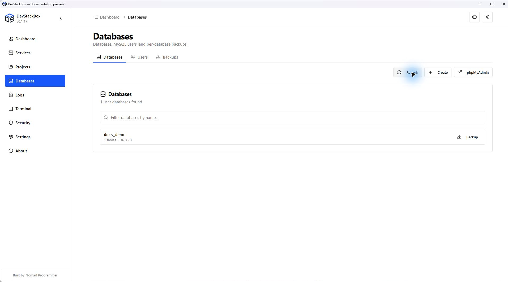

# Databases and MySQL users

Start MySQL before opening **Databases**. Open phpMyAdmin only when both Apache and MySQL are running. The app uses its configured local MySQL client credentials; an authentication error is different from an empty database list.

## Create and inspect a database

1. Open **Databases** and refresh the list.
2. Choose the create action, enter the database name and submit.
3. Confirm the new name appears. Update your application's database connection settings separately; creating a database does not connect a project automatically.
4. Use the per-database backup action before risky changes. Use phpMyAdmin for tables, SQL queries and privileges not exposed by the desktop UI.

Search/filter controls affect the displayed list. Right-click a database row to find **Drop database** in its context menu. Deleting a database requires confirmation and removes its data; a successful deletion is not reversible without a suitable backup.

## Users and account hosts

Open **Databases → Users**. A MySQL account is a username plus a host, so `example@localhost` and the same name at another host are distinct accounts.

1. Choose the create-user action and enter username, host and password.
2. Review the account scope and create it.
3. Refresh the list to confirm the account.
4. Grant only the application's needed database privileges using phpMyAdmin or SQL.

Creating a user in this screen does **not** automatically grant database privileges. The backend creates the account; database grants require a separate step.

Use the password action to change an existing account's password. Update applications and saved client connections that use it. Changing the local root password through the app updates its stored local root credential for supported local hosts. Changes made in another client can leave the app's stored credential out of sync.

Deleting a user removes that account, not its databases. Review the host and username in the confirmation, especially for administrative accounts.

## Root-password prompt and connection failures

The startup root-password prompt is guidance based on the security check. Dismissing it does not set a password. Use the Users screen to manage the local account while the app can authenticate.

If a list fails to load, read the error, confirm MySQL is running and verify its port and credentials. Do not create a new empty data directory to fix an authentication error. Password recovery for an inaccessible server is an administrative operation; retain your data and seek help with the exact error.

See [SQL backups and restore](database-backups), [Security checks](security) and [Troubleshooting](../advanced/troubleshooting).

*Source preview, 23 October 2026. Isolated demonstration data; includes unreleased wording changes.*
