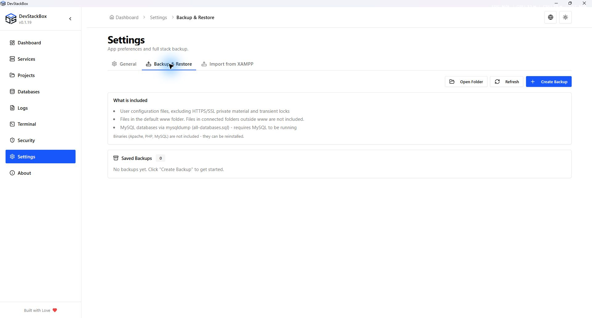

# Full backup and restore

Open **Settings → Backup & Restore**. A full backup combines selected DevStackBox files with an optional SQL export. It is not an image of the computer or every connected project.

## Included and excluded contents

| Content | Included? |
| --- | --- |
| User configuration files | Yes, except excluded HTTPS/SSL material and the transient HTTPS operation lock |
| Files in the installation's default www folder | Yes |
| MySQL server SQL dump | Only when DevStackBox MySQL is running and the export succeeds |
| Files in connected project folders outside www | No; back them up separately |
| Service logs, runtime binaries and terminal history | No |
| HTTPS private material under config/https and config/ssl | No; provision/repair local HTTPS separately after recovery |

Configuration may remember an external project's location without storing its files. A restored path is useful only when that folder still exists and is accessible.

## Create and inspect a backup

1. Back up external project folders separately.
2. Start MySQL if the archive must include databases.
3. Choose **Create backup** and wait for completion.
4. Read any **MySQL skipped** warning. A ZIP without SQL is not a database backup.
5. Inspect the saved list and use the folder action to locate the archive. Copy important archives to another storage location.

Backups are stored under the user data root's `backups/full` folder. If MySQL is running but the dump fails, creation reports failure; do not assume the incomplete file is usable.

## Restore

1. Keep a separate copy of the current configuration, project files and database export.
2. Stop work that writes to the affected files/databases and read the confirmation for the selected archive.
3. Restore and wait for the result. Matching configuration and www files can be overwritten; included SQL is executed against MySQL.
4. Check the restored service configuration, restart as needed and test each website and database.
5. Repair local HTTPS if certificates or trust material are missing.

Restoration is not an all-or-nothing rollback. A failure may leave some files or SQL changes applied. External project files are not restored. Existing unrelated files are not necessarily removed just because they are absent from the archive.

## Delete or recover

The delete action permanently removes the selected archive after confirmation. It does not delete the live project. Keep another verified copy before deleting your only recovery point.

If restoration fails, preserve the archive, error and current state. Use the saved pre-restore copies for a deliberate recovery rather than repeatedly importing the same SQL. See [SQL restoration](database-backups) and [configuration history](configuration-editor).

*Native 1920 × 1032 capture of the v0.1.19 production build, 26 October 2026, using an isolated demonstration profile. Screenshots document the interface; download availability is shown separately on the website.*
