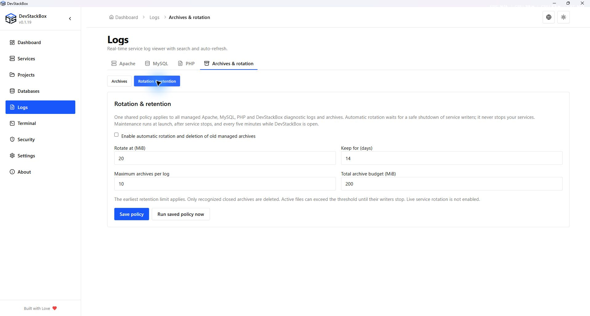

# Service and project logs

Open **Logs** and choose Apache, MySQL or PHP. Apache and MySQL also have Logs tabs in their service workspaces. These views help diagnose a request or startup error; they are not independent log files for each project.

## Find the relevant error

1. Note the current time and reproduce the failing action once.
2. Choose the service and refresh. Compare the timestamp and path with the failing site.
3. Search or inspect the relevant lines. Use auto-scroll when watching new output and pause it to read older lines.
4. If auto-refresh is available, it refreshes the view at the displayed interval. Manual Refresh requests another read.
5. Copy the relevant error text for a report after removing secrets and personal information.

The updated log workspace below is implemented and tested in a local v0.1.18 build; published installers may still show the older viewer.

## Live log and Clear view

Choose **Apache**, **MySQL** or **PHP**, then select the managed file. Apache offers error, access and DevStackBox crash logs. PHP offers the global log and branch-specific logs, including legacy PHP 8.1 history. This does not enable installation or activation of PHP 8.1.

**Clear view** hides all entries up to the current file position. Auto-refresh continues with new entries instead of repopulating old lines. It does not delete data or free disk space. **Show recent history** restores the recent tail. The viewer retains at most 1,000 lines and 512 KiB; it is not a complete-file export. Copy and download apply to the displayed tail.

Auto-refresh reads incrementally every two seconds while changing, slows to ten seconds when idle, and pauses when the window is unfocused or hidden. Only the selected log is polled. Errors keep the previous output visible with a warning.

## Archive or delete a log

**Archive current log** creates a GZIP recovery copy, verifies its SHA-256 and original size, and only then empties the active file. Stop Apache or MySQL first; for PHP, close PHP terminals and other PHP writers as well. Locked files remain unchanged. Archiving does not stop services for you. Live Apache/MySQL rotation is not enabled in this build.

**Delete log contents…** permanently empties the selected file without a backup. Type its exact filename to confirm. The operation refuses a file that changed after review. Prefer archiving when investigating an issue.

Open **Logs → Archives & rotation → Archives** to view the verified recent tail, export the complete `.log.gz`, open the archive folder, or explicitly delete an archive. Exports require a new destination filename. Archives are shared across service tabs and stored under the user-data `logs/archives` directory. Unknown files and incomplete archives are not automatically removed.

## Automatic rotation and retention

One saved policy applies to all managed Apache, MySQL, PHP and DevStackBox diagnostic logs. Service workspaces link to the same management page instead of showing separate settings. Automatic maintenance is **off by default**. In **Logs → Archives & rotation → Rotation & retention**, review and save the policy before enabling it. Defaults are a 20 MiB rotation threshold, 14 days, 10 archives per log, and a 200 MiB combined archive budget. The earliest retention limit applies to recognized closed archives only.

Maintenance runs at launch, after service stops and every five minutes while DevStackBox is open. It is independent of the viewer refresh timer. Service logs wait for their writers to stop; active files may exceed the threshold until then. Crash-log writes and maintenance are serialized. The scheduler does not run while DevStackBox is closed.

Custom log destinations, MySQL binary/relay/redo/undo logs, database files and PID files are excluded. The UI displays the managed path so you can check whether your custom configuration writes somewhere else.

## Global versus project PHP logs

**Projects → Manage project → Server logs** selects Apache errors and the PHP log associated with the saved runtime selection. A pinned runtime can use a different PHP log from the global runtime. Check the displayed source and read errors; custom destinations may need to be opened separately.

Logs can be shared across websites using the same service or runtime. A line in the current view is not automatically attributable to the current project.

## Empty, old or unreadable logs

An empty file can mean no entries were written there. It does not establish that a website is healthy. Check that the service is running, that the request reached the intended hostname, and that logging points to the expected file. A missing-file or access error is a diagnostic result, not an empty successful read.

For startup and configuration errors, see [Troubleshooting](../advanced/troubleshooting). An Apache error naming a parent `.htaccess` happens before Laravel executes; the [project guide](../getting-started/projects) explains the v0.1.17 policy.

## Keep logs separately

Full-stack backups do not include service logs. Preserve relevant logs separately when investigating a failure or before removing a development profile.

*Native 1920 × 1032 capture of the local v0.1.19 production build, 26 October 2026. Isolated audit profile; automatic maintenance is off. This build has not been published.*
