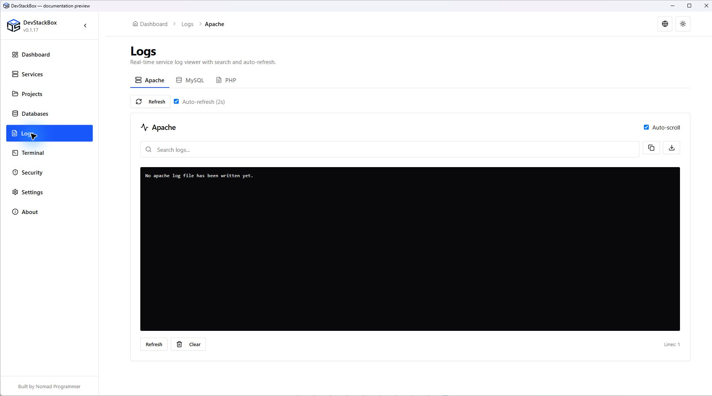

# Service and project logs

Open **Logs** and choose Apache, MySQL or PHP. Apache and MySQL also have Logs tabs in their service workspaces. These views help diagnose a request or startup error; they are not independent log files for each project.

## Find the relevant error

1. Note the current time and reproduce the failing action once.
2. Choose the service and refresh. Compare the timestamp and path with the failing site.
3. Search or inspect the relevant lines. Use auto-scroll when watching new output and pause it to read older lines.
4. If auto-refresh is available, it refreshes the view at the displayed interval. Manual Refresh requests another read.
5. Copy the relevant error text for a report after removing secrets and personal information.

The shared service workspace viewer offers **Auto-refresh (2s)**. Clearing the displayed output clears the view; it does not rotate or delete the underlying log, and a later refresh can show the same lines again.

## Global versus project PHP logs

**Projects → Manage project → Server logs** selects Apache errors and the PHP log associated with the saved runtime selection. A pinned runtime can use a different PHP log from the global runtime. Check the displayed source and read errors; custom destinations may need to be opened separately.

Logs can be shared across websites using the same service or runtime. A line in the current view is not automatically attributable to the current project.

## Empty, old or unreadable logs

An empty file can mean no entries were written there. It does not establish that a website is healthy. Check that the service is running, that the request reached the intended hostname, and that logging points to the expected file. A missing-file or access error is a diagnostic result, not an empty successful read.

For startup and configuration errors, see [Troubleshooting](../advanced/troubleshooting). An Apache error naming a parent `.htaccess` happens before Laravel executes; the [project guide](../getting-started/projects) explains the v0.1.17 policy.

## Keep logs separately

Full-stack backups do not include service logs. Preserve relevant logs separately when investigating a failure or before removing a development profile.

*Source preview captured 23 October 2026; includes unreleased wording changes. Demo state, not recommended settings.*
