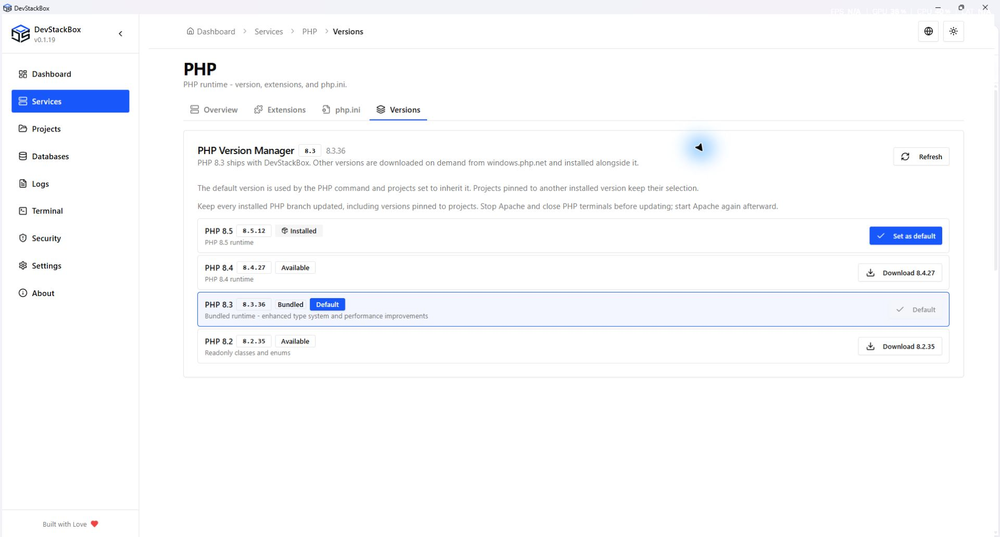
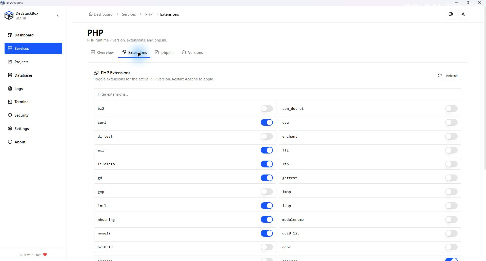
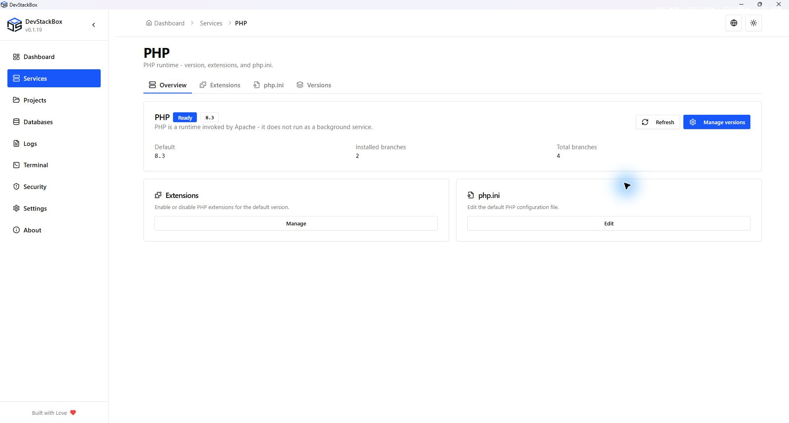

# PHP runtimes and extensions

Open **Services → PHP**. The Overview, Extensions, php.ini and Versions tabs cover different aspects of the runtime. PHP 8.3 is bundled in v0.1.19; supported additional branches are downloaded on demand. The app displays the actual patch release rather than treating a branch label as a complete version.

## Download or update a branch

1. Open **Versions** and refresh the available releases.
2. Read the installed and available patch labels. **Download** installs a branch; **Update to** replaces an installed branch with the displayed patch.
3. Before an update, stop Apache and close terminal sessions using PHP. Also consider projects pinned to that branch.
4. Start the operation and wait for completion. Download, verification and installation can fail independently; keep the exact error.
5. Start Apache again and verify the affected websites.

Update every installed branch used by projects, not only the global default. Unsupported PHP 8.1 is no longer offered for installation or activation. A release-unavailable state is not evidence that the installed runtime is current.

## Change global PHP

Choose **Set as default** for an installed, eligible branch and verify the **Default** badge. The short label such as 8.3 identifies the branch; the full label such as 8.3.36 identifies its patch. Reopen terminal sessions to pick up the global runtime.

The global selection affects default websites and the terminal. A project pinned to an installed branch remains pinned. In **Projects → Manage project → PHP & tools**, select a runtime or **Use global default**. See the [project guide](../getting-started/projects).

## Extensions

1. Open **Extensions** and check the default global runtime.
2. Filter the list to find the extension.
3. Toggle a switchable module; built-in entries cannot be enabled or disabled in the same way.
4. Restart Apache and verify that the application can load the module.

The extension UI targets the default global runtime, not every pinned project's generated ini. If a framework still reports a missing extension, verify the runtime serving that website and its loaded configuration before changing more files.

Fresh global and pinned profiles enable bundled `mysqli`, `pdo_mysql`, `pdo_sqlite`, `sqlite3`, `mbstring`, `openssl`, `curl`, `gd`, `zip`, `intl`, `fileinfo`, `exif`, `sockets` and `sodium` extensions when their DLLs are present. Laravel's core modules such as Ctype, DOM, Filter, Hash, PDO, Session, Tokenizer and XML are compiled into the bundled PHP. Existing profiles retain explicit extension choices. Optional third-party modules such as Imagick are not bundled; GD supplies image support. Individual plugins and applications may require additional modules.

These defaults follow the [Laravel requirements](https://laravel.com/docs/12.x/deployment#server-requirements) and [WordPress server guidance](https://make.wordpress.org/hosting/handbook/server-environment/). Check each project's dependency requirements as well.

## Temporary files

Missing or empty `sys_temp_dir` and `upload_tmp_dir` are initialized to the user's DevStackBox `tmp` directory. The directory is created per user; no developer username is baked into the installer. The fix applies to new profiles and older configurations, including pinned runtime ini files. Nonempty custom paths are preserved: ensure those paths exist and are writable. Restart Apache after configuration changes; existing PHP processes retain their old settings.

## php.ini and information

Use **php.ini** for the global user copy and [configuration history](configuration-editor). Updates preserve user settings within the documented migration limits; this is not a promise that every directive is untouched. The runtime information action helps identify configuration and extensions; avoid publishing its complete output because it can expose local paths and environment details.

## Recover from failure

For a failed download, check connectivity, available disk space and the error stage. Do not bypass failed integrity verification. For locked files, stop processes using that runtime before retrying. If setting the default fails, confirm the runtime is fully installed and meets the supported baseline; do not manually replace the current junction while Apache is serving requests.

*Native 1920 × 1032 capture of the v0.1.19 production build, 26 October 2026, using an isolated demonstration profile. Screenshots document the interface; download availability is shown separately on the website.*

*Native 1920 × 1032 capture of the v0.1.19 production build, 26 October 2026, using an isolated demonstration profile. Screenshots document the interface; download availability is shown separately on the website.*

*Native 1920 × 1032 capture of the v0.1.19 production build, 26 October 2026. Isolated demonstration profile; release availability is shown separately.*

## Windows package revisions

The PHP Versions screen can show package versions such as `8.4.27-1`. The numeric suffix identifies a Windows package rebuild; `PHP_VERSION` may still report `8.4.27`. DevStackBox compares package revisions when offering updates and records the verified release after installation. Older installations without a package receipt may be offered the rebuild once so its revision can be verified. Checksums and runtime version checks remain required.

If release lookup fails, the Versions screen shows the backend reason beneath the retry message. Installed runtimes remain listed.

## Refreshing PHP information

Overview, Extensions and Versions share session-cached PHP version information for up to five minutes. Navigating between tabs does not repeat the release request while that result is fresh. Extension lists are cached per branch. Installing or switching PHP invalidates related information; changing extensions invalidates the extension list and configuration reads. Use **Refresh** to check immediately after changing PHP outside DevStackBox. Failed release checks have a short retry window rather than a long-lived cache.

Configuration reads are reused for up to one minute across visits; **Reload** reads from disk immediately. Unsaved drafts remain separate from the read cache. Save and Restore invalidate the affected configuration and backup list.
