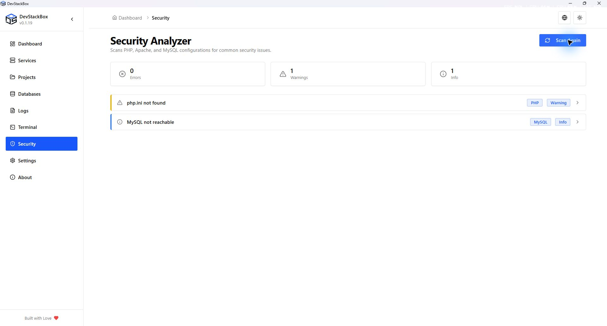

# Security configuration checks

Open **Security** and choose **Run Scan**. The analyzer checks selected PHP, Apache and MySQL configuration conditions and groups findings as errors, warnings or information.

## Read a finding

1. Run the scan and wait for its result.
2. Expand a finding to read its explanation and recommendation.
3. Use its configuration or account destination when available. An **Open Config** action opens the editor; it is not an automatic repair.
4. Make the appropriate change, restart the affected service if needed, then scan again.
5. Test the application after changing settings such as PHP error display or Apache directory behavior.

Examples include exposed PHP/Apache version information, PHP include settings, directory listing and MySQL account conditions. Not every finding has the same consequence in a local development environment; read the explanation before changing application behavior.

## Limits of the result

The analyzer is not a comprehensive vulnerability scan, a source-code audit or proof that the stack is safe to expose publicly. It does not replace updating installed PHP branches and other components.

MySQL checks need a reachable server and usable credentials. “Not reachable” can mean a stopped server or authentication problem, not that account checks passed. Missing configuration also limits what can be checked. A clean result only applies to the checks that ran against the inspected state.

## Root-password guidance

The startup root-password prompt directs you to account management. Dismissal does not fix the finding. See [Databases and users](databases) for local root credentials and application connection consequences.

Local HTTPS protects connections to the configured hostname; certificate trust is separate from website health or secure application code. See [Local HTTPS](local-https).

## Reporting

For an ordinary app defect, include the installed version, relevant sanitized finding/error and reproduction steps. For a suspected vulnerability, follow the [security policy](https://www.devstackbox.com/security) instead of posting credentials or private security details in a public issue.

*Native 1920 × 1032 capture of the v0.1.19 production build, 26 October 2026, using an isolated demonstration profile. Screenshots document the interface; download availability is shown separately on the website.*
