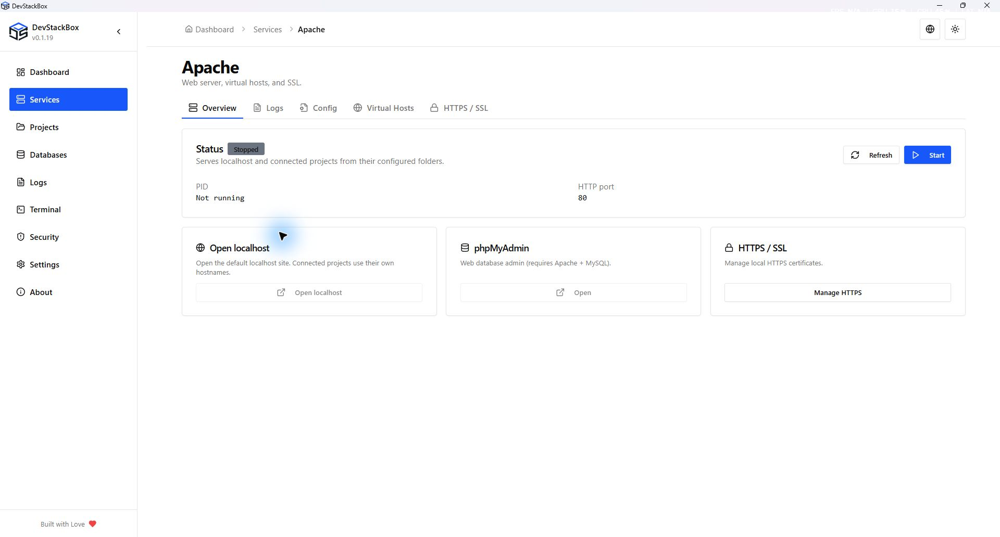

# Services and server controls

Open **Services** to manage the bundled Apache and MySQL servers and inspect the global PHP runtime. Before starting, ensure the configured ports are available. Another XAMPP, IIS or database service may already be listening.

## Start, stop and restart

1. Choose **Start** on the service you need, or use **Start All**.
2. Wait for the status to settle. Read the error if startup fails; repeatedly pressing Start does not fix a port or configuration problem.
3. Open localhost or phpMyAdmin from the appropriate card to test a request.
4. Use **Stop** before replacing runtime files. **Restart All** interrupts requests and database connections; save work before using it.

The Services page links to dedicated Apache, MySQL and PHP workspaces. Overflow and context menus provide configuration and log shortcuts.

## Apache overview

Open **Services → Apache → Overview** for process and port information. Localhost serves the default installation's `www` folder. Connected projects use their configured document roots, which may be elsewhere on disk, and their own hostnames.

**Open localhost** opens the default web root. Connected projects can use other accessible folders and their own hostnames. The phpMyAdmin action requires both Apache and MySQL. The HTTPS entry opens [local certificate management](local-https).

## MySQL overview

Open **Services → MySQL → Overview** for status, port and version. phpMyAdmin opens in a browser; the database service itself does not serve an HTTP page. Use its Logs and Config tabs to diagnose startup or change settings. Database creation, users and SQL exports are in **Databases**, not the overview.

## PHP overview

PHP Ready indicates an installed runtime. There is no separate persistent PHP server to stop like MySQL. Use **Services → PHP** for information, extensions, ini configuration and versions. See [PHP runtimes and extensions](php) before changing a global or pinned runtime.

## Failure and recovery

- For port conflicts, identify the owning service in [Networking](../advanced/environment); change ports deliberately and update clients.
- For invalid configuration, read the error and use [configuration history](configuration-editor).
- For server startup failures, inspect [logs](logs). Do not delete MySQL data to make a failed startup disappear.
- A running process with an HTTP 404/500 needs [project diagnosis](../getting-started/projects), not necessarily a service restart.

*Native 1920 × 1032 capture of the v0.1.19 production build, 26 October 2026. Isolated demonstration profile; release availability is shown separately.*
