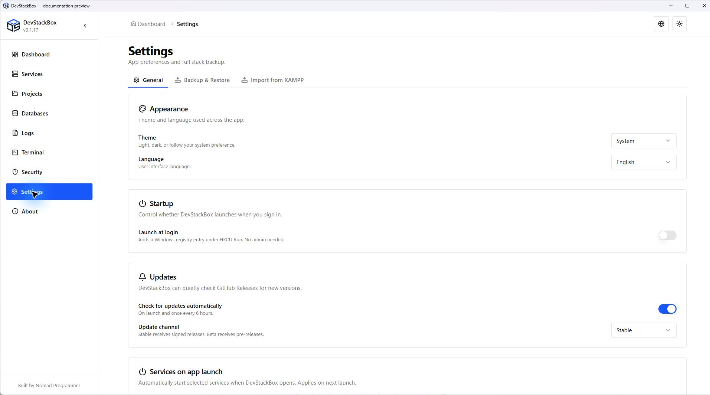

# Settings, tray and About

Open **Settings → General**. Changes have different activation times; follow the hint beside each setting.

## Appearance and language

Choose Light, Dark or System theme and English or Hindi UI language. Header controls offer the same types of choices. Website documentation is currently English; choosing Hindi in the app does not translate the website.

## Startup and closing the window

**Launch at login** controls whether Windows starts DevStackBox when you sign in. It is distinct from **Auto-start Apache** and **Auto-start MySQL**, which apply when DevStackBox opens.

**Minimize to tray on close** hides the window and keeps the app available in the tray. Reopen it from the tray. The tray also provides service actions and Quit. Quit exits the app; do not use window disappearance as proof that every server has stopped. Use **Stop All** and verify service state when you need the stack shut down.

## Updates

Automatic checks run on launch and periodically when enabled. Read the activation hint after changing the preference. The channel preference controls stable versus prerelease discovery; selecting a channel does not install a release or guarantee that a newer package exists.

Open **About → Check for updates** for a manual check. When an update is available, review the version and follow the verified download/install flow. Save work and back up first. If verification fails, retain the error and do not bypass it. See [Upgrading](../getting-started/upgrading).

## About and support

The About page shows app and system/runtime information. Use its installed app version when reporting a bug; PHP's patch version is a different component version. An information load failure should be reported as such rather than interpreted as a zero or missing installation.

A useful report includes the action, expected and actual result, app version, Windows version and relevant sanitized log lines. Avoid sending complete environment output or credentials.

## Other settings screens

[Full backup and restore](full-backup) manages ZIP archives. [Import from XAMPP](xampp-migration) copies project files. Neither changes your theme/startup preferences merely by opening it. Use the project guide when you want to connect a folder without copying files.

*Source preview captured 23 October 2026; includes unreleased wording changes. Demo state, not recommended settings.*
