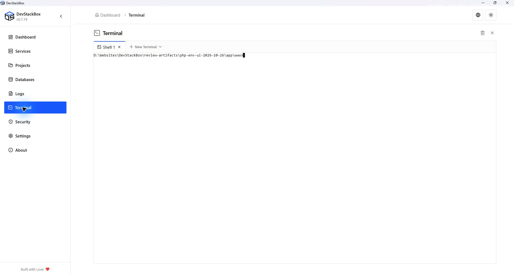

# Terminal tabs and shells

Open **Terminal** to use local shell tabs. Commands run on your computer with the app's privileges; the terminal is not a sandbox.

## Open and use a session

1. Choose Shell, PowerShell, CMD, PHP Interactive or MySQL CLI from the tab controls. Shell and CMD both use the Windows command interpreter.
2. Inspect the prompt and current directory before running project commands.
3. Change to the intended project folder explicitly. A project hostname or pinned website runtime does not automatically change the shell's directory or PHP.
4. In a Shell, CMD or PowerShell tab, run a harmless version check such as `php -v` when verifying the global CLI runtime. PHP Interactive opens `php -a` and expects PHP input instead of shell commands.
5. Switch tabs to keep sessions separate. The app allows ten tabs; close an unused session if a new tab cannot be opened. Closing the last tab creates a new default Shell tab.

Navigating away from Terminal keeps its mounted sessions available while the app is running. This is not session restoration after an app restart.

## Clear versus close

**Clear** clears the active terminal's scrollback display. It does not undo commands or remove files. Closing a tab or using **Kill** ends its session; stop or save any work in that shell first.

## PHP and MySQL

Terminals use global PHP, even when a website is pinned to a different branch. Reopen sessions after changing the global runtime. Project-aware terminal selection is not implemented.

The MySQL CLI is a separate client session. Authentication can fail even when the app's database list works; supply the credentials required by that client rather than assuming the app's stored credential is injected into every shell. Do not put passwords in screenshots or command history.

Git Bash is not currently offered in the shell selector. A Git-related legacy route does not establish a supported Git Bash session.

## Session failures

Read the launch error, check the executable and working directory, then create a new tab. For missing PHP executables use [PHP Versions](php). If only a project command fails, inspect that application's dependencies and environment; DevStackBox does not install Laravel/WordPress dependencies when connecting a folder.

## PHP in external terminals

The updated installer registers `C:/devstackbox/bin` in the machine PATH. Its native `php.exe` launcher resolves the current default runtime on every invocation and uses the current Windows user's DevStackBox configuration. It does not set a machine-wide `PHPRC` or copy one user's profile path into another user's configuration. Open a new terminal after installation; restart an already-open IDE or Windows Terminal if it still has the old environment.

Run `where.exe php`, `php -v`, and `php --ini` to check resolution. Existing PATH entries are preserved and the DevStackBox entry is appended. If another PHP comes first, either adjust PATH deliberately or run `C:/devstackbox/bin/php.exe` explicitly. Uninstall removes only the PATH entry that DevStackBox added; upgrades retain it without duplicates.

The launcher forwards arguments, standard input/output and exit codes. PHP's `-n`, `-c` and `-d` options remain available for explicit overrides. A project-pinned web runtime does not change external CLI PHP; use an explicit versioned executable and that project's ini when needed. Portable copies do not change the machine PATH automatically.

*Native 1920 × 1032 capture of the v0.1.19 production build, 26 October 2026. Isolated demonstration profile; release availability is shown separately.*
